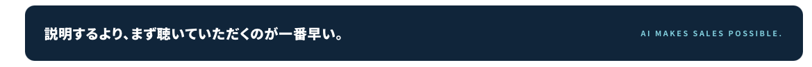

# やってはいけない（NG集）

LP（`index.html` と派生ページ）で、やらないと決めたこと。新しい節や帯を足す前に必ず読む。根拠は `DESIGN.md` の第0章「決定事項」。

| # | やってはいけないこと | 代わりにどうするか | 記録日 |
| --- | --- | --- | --- |
| 1 | **反対色（濃紺・黒・濃いティール）のボックスや帯に白文字を載せる。** セクションの締めのコピーを濃紺の角丸ボックスに入れる、提案資料PDFのスライド下部の濃紺帯をそのまま再現する、など | 帯は淡いティール `#EAF6F8` の単色。文字は見出し色 `#0A2A44`、強調はティール `#007D8C`。白基調を崩さない | 2026-10-13 |

## 事例

### 1. 反対色の帯（2026-10-13）

- 場所: `index.html` の「まずは、実際のTELEMOをお聴きください。」の締めの帯（`.telemo-listen__band`）
- 何が悪いか: 白基調のページに濃紺の面が突然入り、提案資料のスライドをそのまま貼ったように見える。`DESIGN.md` 第0章「濃紺・濃いティールの面は作らず、帯は淡いティール `#EAF6F8` の単色にする」に反する
- 直し方: 背景を `#EAF6F8`、本文を `#0A2A44`、英字ラベルをティール `#007D8C` に変更（`telemo-listen.css`）
